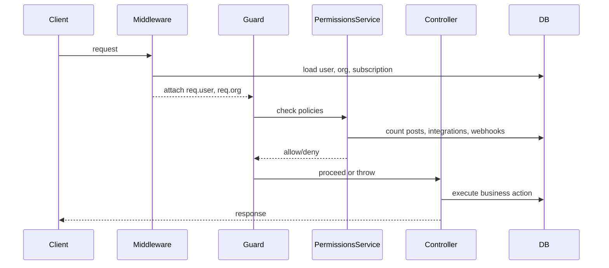

# Roles and Permissions Feature Analysis

## 1. Feature Overview
This feature controls backend authentication, organization scoping, role-based authorization, and subscription/feature gating in the Postiz backend. It is implemented across:
- `apps/backend/src/services/auth/auth.middleware.ts`
- `apps/backend/src/services/auth/permissions/permissions.guard.ts`
- `apps/backend/src/services/auth/permissions/permissions.service.ts`
- `apps/backend/src/services/auth/permissions/permissions.ability.ts`
- `apps/backend/src/services/auth/permissions/permission.exception.class.ts`
- route files under `apps/backend/src/api/routes/` and `apps/backend/src/public-api/routes/v1/`

## 2. Feature Purpose
- Provides authenticated access to organization-backed API routes.
- Enforces role-based access for admin/super-admin actions.
- Implements subscription and quota-based gating for features like channels, posts, webhooks, AI, and team members.
- Protects public API integrations with API keys/OAuth tokens.

## 3. User Flow
This is primarily a backend authorization flow with no direct UI described in the code. The flow is:
1. Client calls a backend route that requires auth or policy checks.
2. `AuthMiddleware` validates session auth, loads the user, selects the organization, and attaches `req.user` and `req.org`.
3. For public API routes, `PublicAuthMiddleware` validates API key/OAuth token and attaches `req.org`.
4. `PoliciesGuard` inspects `@CheckPolicies` metadata on the handler.
5. If policies are present, `PermissionsService.check(...)` verifies the requested actions against the org subscription and user role.
6. The controller executes if allowed; otherwise, a `SubscriptionException` is thrown.

Mermaid sequence:

## 4. Backend / System Flow
### Authenticated route flow
- Route handler is registered in `apps/backend/src/api/api.module.ts` under `authenticatedController`.
- `AuthMiddleware` is applied to those controllers via `consumer.apply(AuthMiddleware).forRoutes(...authenticatedController)`.
- In `AuthMiddleware`:
  - Reads `req.headers.auth` or `req.cookies.auth`.
  - Verifies JWT signature with `AuthService.verifyJWT(auth)`.
  - Loads the full user record from `UsersService.getUserById(payload.id)`.
  - Rejects if missing or not activated.
  - If `user.isSuperAdmin` and an impersonate header/cookie exists, loads impersonated org user and sets `req.user` to impersonated user while keeping `isSuperAdmin = true`.
  - Loads organizations for the user and selects the active org from `showorg` or first non-disabled org.
  - Ensures `org.apiKey` exists, calling `OrganizationService.updateApiKey(setOrg.id)` if needed.
  - Attaches `req.user` and `req.org`.

### Public API route flow
- `PublicApiModule` applies `PublicAuthMiddleware` to `PublicIntegrationsController`.
- `PublicAuthMiddleware` accepts either a bearer API key or OAuth token.
- It loads the org by API key or OAuth auth record.
- If `STRIPE_SECRET_KEY` is configured, it rejects orgs without a subscription.
- It sets `req.org` with a synthetic `SUPERADMIN` role object for policy evaluation.

### Guard and policy flow
- `PoliciesGuard` is globally registered in `apps/backend/src/app.module.ts` via `APP_GUARD`.
- It bypasses policy enforcement for paths containing `/auth`, `/integrations/social-connect`, and `/integrations/provider`.
- It reads `@CheckPolicies` metadata from the route handler.
- If metadata is absent, access is allowed.
- If metadata is present, it calls `PermissionsService.check(org.id, org.createdAt, org.users[0].role, policyHandlers, refreshChannelId)`.
- If any requested policy denies the action, it throws `SubscriptionException`.

## 5. API Endpoints
| Method | Path | Purpose | Auth Required | Permission/Role Required |
|---|---|---|---|---|
| POST | `/integrations/provider/:id/connect` | Connect a social integration | Yes | `Sections.CHANNEL` |
| GET | `/integrations/social/:integration` | Start social integration oauth flow | Yes | `Sections.CHANNEL` |
| POST | `/posts/` | Create a post | Yes | `Sections.POSTS_PER_MONTH` |
| POST | `/posts/generator` | Generate posts via AI | Yes | `Sections.POSTS_PER_MONTH` |
| POST | `/autopost/` | Create autopost automation | Yes | `Sections.WEBHOOKS` |
| POST | `/webhooks/` | Create webhook | Yes | `Sections.WEBHOOKS` |
| POST | `/copilot/agent` | Start AI agent flow | Yes | `Sections.AI` |
| GET | `/copilot/:thread/list` | List copilot messages | Yes | `Sections.AI` |
| GET | `/settings/team` | Query team members | Yes | `Sections.TEAM_MEMBERS`, `Sections.ADMIN` |
| POST | `/settings/shortlink` | Update shortlink settings | Yes | `Sections.ADMIN` |
| POST | `/user/api-key/rotate` | Rotate org API key | Yes | `Sections.ADMIN` |
| GET | `/user/subscription` | Read subscription info | Yes | `Sections.ADMIN` |
| GET | `/admin/errors` | View platform errors | Yes | `isSuperAdmin` |
| GET | `/admin/stats` | View admin stats | Yes | `isSuperAdmin` |
| POST | `/enterprise/create-user` | Enterprise user creation via signed payload | No standard middleware | Signed JWT request payload |

## 6. Database / Data Model
- `User` from Prisma: used for authentication and `isSuperAdmin`.
- `Organization` from Prisma: contains subscription, apiKey, and `users[0].role`.
- `Subscription`: loaded by organization id, used for tier/quota checks.
- `Integration`: counted for `Sections.CHANNEL` and refresh logic.
- `Webhook`: counted for `Sections.WEBHOOKS`.
- `Post`: counted for `Sections.POSTS_PER_MONTH`.

Key assumptions:
- `org.users[0].role` is treated as the active role for authorization.
- Organization selection is based on `showorg` or the first non-disabled org.

## 7. Business Rules
- Authenticated routes require a valid JWT and an active user.
- If the user is super-admin and `impersonate` is provided, requests may run as the impersonated org user.
- `Sections.CHANNEL` creation is allowed when the org is under channel quota, or when refreshing an existing channel for the same org.
- `Sections.POSTS_PER_MONTH` creation is allowed when posts in the current subscription window are below quota.
- `Sections.WEBHOOKS` creation is allowed when total webhooks are below quota.
- `Sections.TEAM_MEMBERS` is allowed when `options.team_members` is enabled.
- `Sections.ADMIN` is allowed only for `ADMIN` and `SUPERADMIN` roles.
- `Sections.AI`, `Sections.COMMUNITY_FEATURES`, `Sections.FEATURED_BY_GITROOM`, and `Sections.IMPORT_FROM_CHANNELS` are gated by subscription feature flags.
- Super-admin-only admin controller actions bypass CASL and check `user.isSuperAdmin` directly.
- Public API routes authorize by API key/OAuth token and treat the org as SUPERADMIN for policy evaluation.

## 8. Edge Cases
- `PoliciesGuard` bypasses `/auth`, `/integrations/social-connect`, and `/integrations/provider`, so those paths are not subject to policy enforcement.
- `EnterpriseController` routes are outside the normal `AuthMiddleware` path and only validate signed payloads, so they do not rely on `req.user` or org role.
- `PermissionsService` does not handle `Sections.VIDEOS_PER_MONTH`, though the section exists in enums and exception handling.
- Org role lookup using `org.users[0].role` assumes the first user entry is the relevant role and may be brittle if ordering changes.
- When `STRIPE_PUBLISHABLE_KEY` is missing, `PermissionsService.check(...)` grants all requested permissions, effectively bypassing policy enforcement.
- `getSelf` exposes `admin: !!user.isSuperAdmin` and `publicApi` only for `ADMIN`/`SUPERADMIN`.
- `AuthMiddleware` selects the first non-disabled org if no `showorg` is specified; if the user belongs to multiple orgs, this may cause unintended org scope.

## 9. Security & Access Control Notes
- `PoliciesGuard` is globally active through `APP_GUARD` in `apps/backend/src/app.module.ts`.
- Controller routes are protected only when `@CheckPolicies` metadata is present; otherwise the request is allowed by the guard.
- `PublicApiModule` also provides the guard, so policy enforcement applies to public API integration routes where configured.
- `AuthMiddleware` performs robust JWT validation and re-loads the user from DB instead of trusting token claims.
- Super-admin impersonation is supported and preserves `isSuperAdmin` while switching the org user context.
- The code does not appear to explicitly check `org.users[0].disabled` in `PoliciesGuard`, only in `AuthMiddleware` when selecting available orgs.

## 10. Test Cases
| Test ID | Type | Scenario | Expected Result |
|---|---|---|---|
| RP-01 | Security | Authenticated route with valid JWT and org | Allowed if org and role valid |
| RP-02 | Security | `@CheckPolicies(Sections.CHANNEL)` on new integration when quota exceeded | `SubscriptionException` thrown |
| RP-03 | Security | `refresh` query uses existing integration id | Channel policy allows refresh even if quota hit |
| RP-04 | Security | Non-super-admin calls `/admin/errors` | Forbidden / `Unauthorized` |
| RP-05 | Security | Public API route with invalid API key | Unauthorized response |
| RP-06 | Boundary | No `STRIPE_PUBLISHABLE_KEY` configured and a policy is requested | Policy is effectively bypassed |
| RP-07 | Gap | Route with `Sections.VIDEOS_PER_MONTH` present only in enum | Recognize missing enforcement in `PermissionsService` |

## 11. Risks & Recommended Improvements
1. Add explicit `Sections.VIDEOS_PER_MONTH` enforcement in `PermissionsService.check(...)` or remove the enum/exception path.
2. Avoid relying on `org.users[0].role`; derive the user's role from the active org-user relation explicitly.
3. Document and confirm the guard bypass paths so `/auth`, `/integrations/social-connect`, and `/integrations/provider` are intentionally excluded.
4. Ensure `PublicAuthMiddleware` policy behavior is consistent with standard auth routes, especially around org role semantics.
5. Add tests covering high-risk flows: channel refresh gating, `POSTS_PER_MONTH`, public API auth, and impersonation.

## 12. Open Questions
- Should `EnterpriseController` routes be brought under the same middleware/guard model or remain separate because of their signed-JWT payload design?
- Does `org.users[0].role` intentionally represent the active role, or should role lookup be more explicit?
- Is the `STRIPE_PUBLISHABLE_KEY` bypass intended as a local/dev shortcut, or does it create a security gap in some deployments?

## 13. Files Analyzed
- `apps/backend/src/services/auth/auth.middleware.ts`
- `apps/backend/src/services/auth/public.auth.middleware.ts`
- `apps/backend/src/services/auth/permissions/permissions.guard.ts`
- `apps/backend/src/services/auth/permissions/permissions.service.ts`
- `apps/backend/src/services/auth/permissions/permissions.ability.ts`
- `apps/backend/src/services/auth/permissions/permission.exception.class.ts`
- `apps/backend/src/app.module.ts`
- `apps/backend/src/api/api.module.ts`
- `apps/backend/src/public-api/public.api.module.ts`
- `apps/backend/src/api/routes/users.controller.ts`
- `apps/backend/src/api/routes/admin.controller.ts`
- `apps/backend/src/api/routes/enterprise.controller.ts`
- `apps/backend/src/api/routes/integrations.controller.ts`
- `apps/backend/src/api/routes/posts.controller.ts`
- `apps/backend/src/api/routes/settings.controller.ts`
- `apps/backend/src/api/routes/autopost.controller.ts`
- `apps/backend/src/api/routes/copilot.controller.ts`
- `apps/backend/src/api/routes/webhooks.controller.ts`
